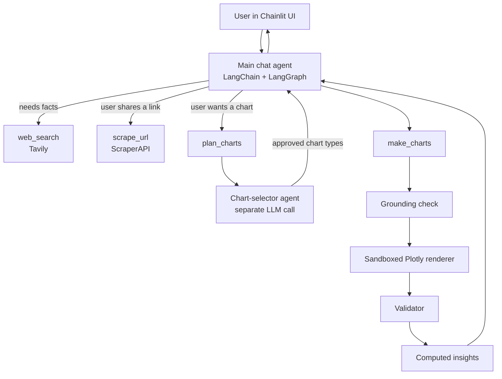

# Agentic Chatbot: Web Research and Auto-Selected Charts

[](https://www.python.org/downloads/)
[](https://chainlit.io)
[](https://langchain-ai.github.io/langgraph/)
[](https://plotly.com/python/)

<!-- Add a screenshot of the chat with a chart in the side panel:  -->

A chat assistant that can **search the web, read web pages and draw charts** from real data. It is built as an *agentic* system: instead of one prompt producing one answer, a main agent decides which tools to call, and a second, specialised agent decides which chart type fits your data.

You can paste a table of numbers, ask a question that needs a web search, or share a link. The assistant gathers the data, picks the right kind of chart, draws it in a side panel and writes key insights from figures calculated in code.

---

## Features

- **Conversational agent with tools:** answers normally in text and calls tools only when needed.
- **Live web research:** searches the web and cites its sources. You choose the search depth with buttons in the chat.
- **Link reading:** paste a URL and the agent reads the page, then explains it or charts the numbers on it.
- **Automatic chart selection:** a dedicated chart-selector agent chooses the chart type from the shape of your data and your request. It does not default to bar charts.
- **10 chart types:** bar, grouped bar, stacked bar, line, area, pie, scatter, histogram, box plot and heatmap.
- **Key insights from code, not guesses:** highest and lowest values, shares, changes over time and correlations are computed in Python. The model only writes them up.
- **No invented data:** every number in a chart must come from your messages or from search and scrape results.
- **Chat history and memory:** multiple chats, each with its own memory. Long conversations are summarised automatically.
- **Recolor and re-type:** ask for "make it red" or "show it as a line chart" and the chart is rebuilt.
- **Bring your own key and model:** each user enters their own OpenAI API key in the app and picks the model from a dropdown of the models that key can use. The key is never stored on the server.

---

## How it works



Drawing a chart is always a **two-step process**:

1. `plan_charts`: the chart-selector agent reads the request and the data and decides the type of each chart.
2. `make_charts`: the main agent fills a validated spec for exactly the planned types. The spec is checked, rendered and verified.

---

## Your API key and model

Nothing is configured on the server for OpenAI. Each user brings their own key:

1. **First visit:** the app shows a **Required API Keys** form. Paste your OpenAI API key (the field is masked) and save.
2. **Model dropdown:** the app asks OpenAI which chat models your key can use and lists them in the chat settings (the settings icon next to the message box). Pick one at any time and it applies to your next message. The same model runs the chat agent and the chart-selector.
3. **Per chat:** the model you pick is remembered for that chat and restored when you reopen it.

How the key is handled:

- It is saved only in your browser's local storage and sent to the app for your session. It is **not** written to the database, the memory files or the logs.
- It is used for your requests only. A fresh agent is built for every message, so a key can never be reused for another user.
- Error messages shown in the chat never contain the key.
- To change it, open the profile menu and choose **API Keys**. On a shared computer, also clear the site's data in your browser.

---

## Agents

| Agent | Role |
|---|---|
| **Main chat agent** | Talks to the user, decides when to search, scrape or chart, calls the tools, fixes its own errors (up to 3 retries) and writes the final answer with key insights. Built with LangChain `create_agent` on LangGraph. Memory is stored per chat in SQLite and is summarised automatically after about 4,000 tokens. |
| **Chart-selector agent** | A separate LLM call with a single job: choose the chart type for each chart. It reads the conversation itself, so the main agent cannot bias it. It returns a structured plan (type, what to plot, why). Code then checks the plan: a type the user named must be honoured, and several charts must use different types. If the plan breaks a rule it gets one retry. If the selector is unavailable, charting still works and the main agent picks the types itself. It runs on the same model the user selected. |

---

## Tools

| Tool | Powered by | What it does |
|---|---|---|
| `web_search` | [Tavily](https://tavily.com) | Searches the web for facts the model does not know or for current information. The user picks the depth (basic, fast, ultra-fast or advanced) with buttons in the chat. Results are treated as untrusted data and sources are cited. |
| `scrape_url` | [ScraperAPI](https://www.scraperapi.com) | Fetches the text of a linked page. Can render JavaScript for dynamic sites. Content is truncated to a safe size and treated as untrusted. |
| `plan_charts` | Chart-selector agent | Decides the best chart type(s) for the request and data. Must be called before `make_charts`. |
| `make_charts` | Plotly | Draws 1 to 3 charts from validated specs. Refuses to run without a plan and rejects types that were not planned. Returns computed facts so the insights are accurate. |

### Chart types and when they are used

| Type | Used for |
|---|---|
| `bar` | One measure across categories, rankings |
| `grouped_bar` | Several measures per category, side by side |
| `stacked_bar` | Parts that add up to a total per category |
| `line` | Trends over time or an ordered sequence |
| `area` | Cumulative size or volume over time |
| `pie` | Share of a whole (7 slices or fewer) |
| `scatter` | Relationship between two numeric measures |
| `histogram` | Distribution of many raw values |
| `box` | Spread and outliers across groups |
| `heatmap` | A measure across two dimensions |

---

## Built-in safeguards

- **Grounded numbers:** every number in a chart must appear in a user message or a tool result. Numbers calculated from given data must be explicitly marked as computed.
- **The model never writes plotting code:** it only fills a validated Pydantic spec. Fixed Plotly templates render the chart.
- **Sandboxed rendering:** charts are rendered in a child process with restricted built-ins and a 15-second timeout.
- **Figure validation:** after rendering, every number in the spec must appear in the figure.
- **Untrusted web content:** page text and search results are treated as data. The agent never follows instructions found inside them.
- **Self-correction:** when a tool returns errors, the agent fixes the spec and tries again.

---

## Tech stack

| Layer | Technology |
|---|---|
| UI | [Chainlit](https://chainlit.io) |
| Agent framework | LangChain, LangGraph |
| LLM | OpenAI, using each user's own key. Model chosen in the UI (default `gpt-4.1-mini`) |
| Charts | Plotly, pandas, NumPy |
| Validation | Pydantic |
| Storage | SQLite (chat history and agent memory), local file storage for charts |
| Web search / scraping | Tavily, ScraperAPI |

---

## Project structure

```
├── app.py               # Chainlit UI: chats, streaming, tool steps, charts, model dropdown
├── agent.py             # Main agent: prompt, tools, SQLite memory; one agent per user key and model
├── openai_models.py     # Lists the models a user's key can use, plain-language OpenAI errors
├── chart_selector.py    # Chart-selector agent: plans chart types and validates its own plan
├── tools.py             # Tools: plan_charts, make_charts, web_search, scrape_url
├── schemas.py           # Pydantic specs, one per chart type
├── charts.py            # Plotly templates for the 10 chart types
├── executor.py          # Runs a chart in a child process with a timeout
├── exec_runner.py       # Sandboxed code runner (restricted built-ins)
├── validator.py         # Checks the figure against its spec
├── grounding.py         # Checks chart numbers exist in the conversation
├── insights.py          # Computes facts for the key insights
├── config.py            # Models, limits and storage paths
├── db_init.py           # Creates the chat history tables
├── local_storage.py     # Stores chart files locally
├── css_colors.py        # Valid CSS color names
├── public/chat.css      # UI styling
├── .chainlit/config.toml # Chainlit settings, including the masked API key form
├── .env.example         # Template for the server's keys
└── requirements.txt
```

---

## Getting started

### Prerequisites

- Python 3.11 or newer
- An **OpenAI API key** (required, entered in the app, not in a file)
- A [Tavily](https://tavily.com) key for web search (optional)
- A [ScraperAPI](https://www.scraperapi.com) key for reading links (optional)

> **Bring your own key.** This project ships with no API keys. Every user enters their own OpenAI key in the app, and calls are billed to that key.

### Install

```bash
git clone https://github.com/<your-username>/<repo-name>.git
cd <repo-name>

python -m venv .venv
# Windows:      .venv\Scripts\activate
# macOS/Linux:  source .venv/bin/activate

pip install -r requirements.txt
```

### Configure

Copy the template and fill in your keys:

```bash
# Windows:      copy .env.example .env
# macOS/Linux:  cp .env.example .env
```

| Variable | Required | Purpose |
|---|---|---|
| `CHAINLIT_AUTH_SECRET` | Yes | Secret for the chat session. Generate one with `chainlit create-secret`. |
| `TAVILY_API_KEY` | No | Enables `web_search`. |
| `SCRAPERAPI_API_KEY` | No | Enables `scrape_url`. |

There is no OpenAI variable: the key is entered in the app. Any `OPENAI_API_KEY` left in `.env` is ignored.

Never commit your `.env` file. It is already listed in `.gitignore`.

### Run

```bash
chainlit run app.py -w
```

Open <http://localhost:8000>. On your first visit, enter your OpenAI API key in the form that appears, then start chatting. Use the settings icon next to the message box to choose the model.

---

## Example prompts

- *Paste a table or list of numbers, then:* "give me the graphs"
- "Show monthly revenue as a trend" (the selector picks a line chart)
- "Show each player's share of total centuries as a pie chart" (an explicit type is always honoured)
- "Search the web for the 10 richest people in India and chart their net worth"
- "Read https://example.com/report and chart the numbers on that page"
- "Make the chart red" or "show it as a scatter plot instead"

---

## Configuration

Settings live in `config.py`:

| Setting | Default | Meaning |
|---|---|---|
| `DEFAULT_MODEL` | `gpt-4.1-mini` | Model preselected in the dropdown, when the user's key can use it |
| `FALLBACK_MODELS` | `gpt-4.1-mini`, `gpt-4.1`, `gpt-4o-mini`, `gpt-4o` | Shown only if OpenAI cannot be asked which models the key can use |
| `MAX_CHARTS` | `3` | Charts per request |
| `MAX_RETRIES` | `3` | Self-correction attempts after a tool error |
| `EXEC_TIMEOUT_SECONDS` | `15` | Time limit for rendering a chart |
| `SUMMARIZE_AFTER_TOKENS` | `4000` | When long chats are summarised |
| `SEARCH_MAX_RESULTS` | `5` | Results per web search |
| `SCRAPE_MAX_CHARS` | `12000` | Maximum page text read from a link |
| `DATA_DIR` | project folder | Where chat history, memory and charts are stored |

---

## Roadmap

- [ ] Export charts as PNG or HTML
- [ ] Upload CSV and Excel files as a data source

---

## Limitations

- **One shared identity.** It signs everyone in automatically as the same user, so all visitors share one chat history list. Visitors pay with their own OpenAI key, but do not host it publicly with private conversations in it. The Tavily and ScraperAPI keys in `.env` belong to the host, and every visitor can use them.
- Charts only use numbers that appear in the conversation or in search and scrape results. If the data is missing, the assistant asks for it.
- At most 3 charts are drawn per request (`MAX_CHARTS`).
- Answers that rely on web search or scraping depend on the quality of the pages found.
